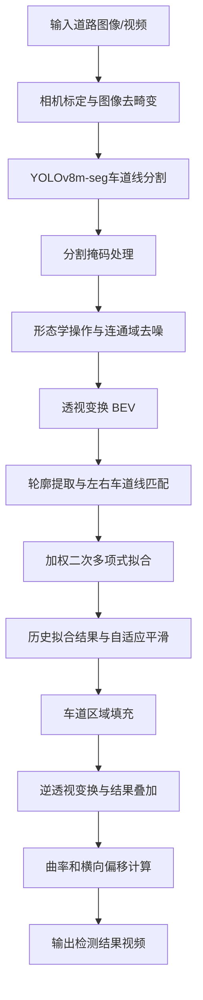
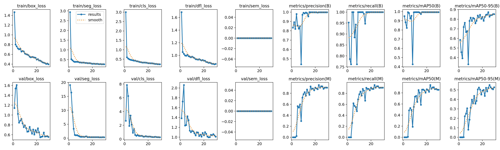
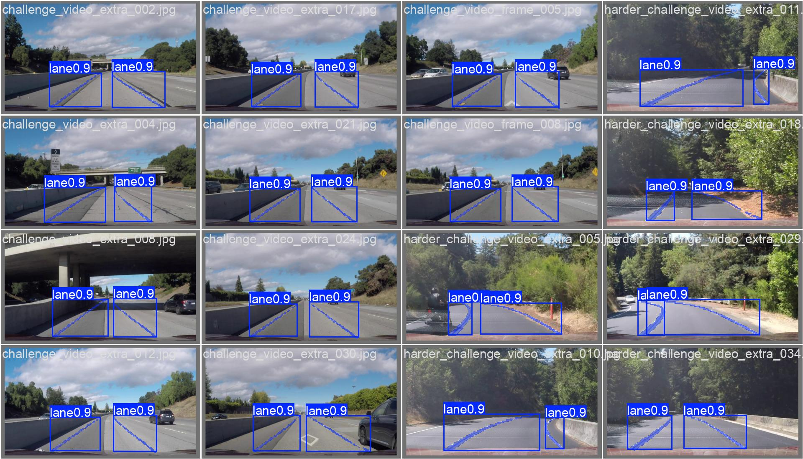

# YOLOv8 Lane Detection

基于 **YOLOv8-seg** 和 **OpenCV** 的车道线检测项目。通过训练车道线分割模型获取车道区域掩码，结合图像预处理、透视变换、轮廓提取、曲线拟合及帧间平滑，实现道路场景下的车道线检测与可视化。

项目以 Udacity CarND-Advanced-Lane-Lines 为基础，将传统的颜色阈值和梯度特征提取方法替换为 YOLOv8 分割模型，并保留和改进后处理流程。

## 1. 项目简介

传统车道线检测方法容易受到光照变化、道路阴影和路面颜色差异的影响。本项目采用 YOLOv8m-seg 对车道线进行像素级分割，再结合 OpenCV 对分割结果进行进一步处理，提取左右车道线并拟合车道曲线。

系统支持视频逐帧处理，可在检测结果中叠加车道区域、曲率半径和车辆相对于车道中心的横向偏移信息。

## 2. 核心功能

- **车道线分割：** 使用 YOLOv8m-seg 模型提取车道线区域。
- **图像预处理：** 通过相机标定和去畸变改善图像质量，并利用形态学操作和连通域分析去除噪声。
- **透视变换：** 将道路图像转换为鸟瞰视角（BEV），便于提取和拟合车道线。
- **车道线提取：** 基于轮廓分析提取左右车道线中心点，并结合历史拟合结果进行左右车道线匹配。
- **曲线拟合：** 使用加权二次多项式拟合车道线，提升车辆近处车道线的拟合稳定性。
- **时序平滑：** 采用自适应指数平滑，减少视频连续帧之间的检测抖动。
- **结果可视化：** 绘制车道区域，并计算曲率半径和车辆横向偏移量。
- **视频处理：** 支持读取输入视频并逐帧处理，生成检测结果视频。

## 3. 算法流程



## 4. 关键实现

### 4.1 YOLOv8 车道线分割

使用 YOLOv8m-seg 作为基础分割模型，将车道线作为单一类别进行训练。

模型推理后获取分割掩码，并将其恢复至原始图像尺寸，合并为二值图像。随后去除图像上半部分的远景区域，减少天空和远处背景对车道线提取的干扰。

### 4.2 分割结果后处理

针对模型输出的分割掩码，采用以下处理方式：

1. 使用形态学开运算去除小型噪声区域。
2. 使用形态学闭运算填补车道线掩码中的空洞。
3. 通过高斯模糊和平滑阈值处理改善掩码边缘。
4. 使用连通域分析过滤面积较小的噪声区域。

### 4.3 鸟瞰图变换与车道线提取

通过透视变换将道路图像映射至鸟瞰视角（BEV），降低透视效应对车道线拟合的影响。

在二值图像中提取有效轮廓，并根据轮廓底部区域的横向位置区分左右车道线。

针对弯道中左右车道线可能同时出现在图像中心同一侧的问题，进一步引入历史拟合结果作为位置先验，通过当前轮廓与历史预测位置之间的距离进行匹配，降低左右车道线错配的情况。

### 4.4 加权曲线拟合与时序平滑

提取左右车道线中心点后，采用二次多项式进行拟合：

`x = a*y² + b*y + c`

拟合时对靠近图像底部、距离车辆更近的点赋予较高权重，以提高车辆近处车道线的拟合可靠性。

针对视频连续帧中检测结果可能出现的抖动，采用自适应指数平滑：

- 当车道线位置变化较小时，增强平滑效果，抑制检测噪声。
- 当车道线位置变化较大时，降低平滑强度，使拟合结果能够更快响应车道变化。
- 当当前帧检测不完整时，优先保留历史拟合结果；尚无历史结果时使用预设的兜底拟合参数。

### 4.5 车道区域与驾驶信息可视化

根据左右车道线拟合曲线构建车道区域，在鸟瞰图中进行填充，再通过逆透视变换映射回原始图像。

同时，根据像素与实际距离的换算参数估算：

- 道路曲率半径（Radius of Curvature）
- 车辆相对于车道中心的横向偏移量（Vehicle Offset）

最终将检测结果叠加到原始图像中。

## 5. 项目效果

### 模型训练结果

项目保存了 YOLOv8m-seg 的训练过程、损失曲线和验证结果。



### 验证集预测结果



### 视频检测结果

仓库中提供了以下处理结果：

- [Project Video 检测结果](output/output_project_video.mp4)
- [Challenge Video 检测结果](output/output_challenge_video.mp4)
- [Harder Challenge Video 检测结果](output/output_harder_challenge_video.mp4)

## 6. 技术栈

| 类别 | 技术 |
|---|---|
| 编程语言 | Python |
| 深度学习框架 | PyTorch |
| 目标分割模型 | YOLOv8m-seg |
| 图像处理 | OpenCV |
| 数值计算 | NumPy |
| 数据可视化 | Matplotlib |
| 数据格式 | YOLO Segmentation |

## 7. 项目结构

```text
YOLOv8-Lane-Detection/
│
├── data/
│   ├── camera_cal/              # 相机标定图片
│   ├── my_dataset/              # 自定义车道线分割数据集
│   │   ├── train/
│   │   │   ├── images/
│   │   │   └── labels/
│   │   ├── val/
│   │   │   ├── images/
│   │   │   └── labels/
│   │   └── dataset.yaml
│   ├── test_images/              # 测试图片
│   └── videos/                  # 输入道路视频
│
├── models/
│   ├── yolov8m-seg.pt           # YOLOv8m-seg 预训练模型
│   └── yolov8n-seg.pt           # YOLOv8n-seg 备用模型
│
├── runs/
│   └── segment/
│       └── runs/
│           └── yolov8m_lane/
│               ├── weights/
│               │   ├── best.pt  # 最佳训练权重
│               │   └── last.pt  # 最后一轮训练权重
│               ├── results.png
│               ├── results.csv
│               └── ...
│
├── output/                      # 视频检测结果
│
├── scripts/
│   └── extract_frames.py        # 视频抽帧脚本
│
├── yolov8/
│   ├── train.py                 # 模型训练
│   ├── convert_data.py          # 数据整理
│   └── convert_harder_label.py  # LabelMe 标注格式转换
│
├── harder_lane_detection.py     # 车道线检测与视频处理主程序
├── requirements.txt
└── README.md
```

## 8. 环境配置

建议使用 Python 虚拟环境。

安装项目依赖：

```bash
pip install -r requirements.txt
```

另外，项目的 `requirements.txt` 中没有包含 Ultralytics，需要单独安装：

```bash
pip install ultralytics
```

如果使用 NVIDIA GPU 进行训练，请根据 CUDA 环境安装兼容版本的 PyTorch。

## 9. 模型训练

项目使用 YOLOv8m-seg 进行车道线分割训练。

训练参数如下：

| 参数 | 设置 |
|---|---|
| 基础模型 | YOLOv8m-seg |
| Epochs | 30 |
| Image Size | 640 |
| Batch Size | 32 |
| Optimizer | AdamW |
| Initial Learning Rate | 0.001 |
| Weight Decay | 0.001 |
| 数据增强 | 开启 |
| Mixed Precision | 开启 |

训练前，需要检查 `data/my_dataset/dataset.yaml` 中的数据集路径。当前仓库配置使用了本地绝对路径，请修改为项目相对路径：

```yaml
path: ./data/my_dataset
train: train/images
val: val/images
nc: 1
names: ['lane']
```

然后执行：

```bash
python yolov8/train.py
```

训练完成后，模型权重保存在：

```text
runs/segment/runs/yolov8m_lane/weights/
```

其中：

- `best.pt`：训练过程中保存的最佳模型权重。
- `last.pt`：最后一轮训练的模型权重。

## 10. 运行车道线检测

确保项目依赖、模型权重和数据文件已准备好，在项目根目录执行：

```bash
python harder_lane_detection.py
```

主程序默认执行以下操作：

1. 加载 `data/camera_cal/` 中的棋盘格图片进行相机标定。
2. 计算透视变换矩阵。
3. 加载训练得到的 YOLOv8m-seg 最佳权重。
4. 逐帧处理 `data/videos/harder_challenge_video.mp4`。
5. 将检测结果保存至：

```text
output/output_harder_challenge_video.mp4
```

目前主程序默认启用 Harder Challenge Video，其他视频处理代码可以在 `harder_lane_detection.py` 的主程序部分按需启用。

## 11. 注意事项

- 当前模型使用单类别车道线分割数据集进行训练，类别名称为 `lane`。
- 当前透视变换源点、车道中心位置及像素到实际距离的换算参数针对项目使用的道路视角设置。更换摄像头或视频分辨率时，需要重新调整相关参数。
- 当前检测流程主要针对固定前视摄像头的道路场景，实际效果会受到光照、阴影、车道线遮挡和路面状况等因素影响。
- `data/my_dataset/dataset.yaml` 中的路径需要根据本地环境修改后才能直接训练。

## 12. 致谢

本项目基于 Udacity 的 CarND-Advanced-Lane-Lines 项目进行改进。

感谢 YOLO、PyTorch 和 OpenCV 等开源项目提供的支持。
